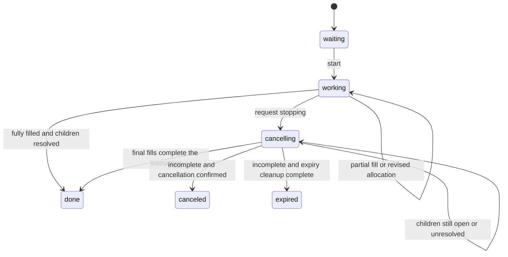

# Routed order lifecycle improvement plan

Status: existing statuses retained; the user-authorized routed cancellation fix is implemented with offline regression tests. Stop-reason consistency and broader saving/recovery changes remain future work. No schema or public status changes were made. Read [shared managed states](managed-states.md) and [current routed behavior](routed.md) first.

## Agreed direction

- Keep the current internal states and public status mapping, including `working` to `triggered`. This is a naming tradeoff, not an execution defect. Document `triggered` as active managed execution for routed orders; a routed parent has no stop-price trigger.
- Keep phase, reason and filled quantity separate. `canceled` with `filled=30`, `remaining=70` and `stop_reason=liquidity` is a useful and coherent outcome for 100 requested.
- Add consistent stop reasons to the to-do list. Record gaps now; do not implement them yet.
- Examine lifecycle transitions next, especially pending cancellation. Saving and recovery follow after the intended transitions are understood.

## Stop reason to do list

- [ ] List the current endings: user cancel, halt, worst price, liquidity, minimum quantity, round limit, maximum age, explicit expiry and execution errors.
- [ ] Specify a structured reason for each applicable ending so clients do not parse `detail` text. Existing routing reasons remain useful.
- [ ] Define which reason wins if events overlap, such as user cancellation followed by expiry or a full fill during cancellation.
- [ ] Decide what to retain when cancellation is still pending: the original stopping cause, intended final state and latest child outcomes.
- [ ] Specify where those fields appear in a normal order response versus a bucket report before changing contracts.
- [ ] Add offline tests after the transition rules are agreed.

The issue is consistent population across paths, not a need to combine reason and fill progress into one status.

## Current lifecycle in plain language

| Step | Internal state | Public status | Relevant code |
|---|---|---|---|
| Parent is constructed | `waiting` | `waiting` | `ManagedOrder.__init__()` |
| Routing starts | `working` | `triggered` | `RoutedLimit.start()` |
| Book changes or part of the quantity fills | Usually still `working` | `triggered` | `on_book()`, `on_fill()`, `on_child_order_updated()`, `_replan()` |
| User cancellation begins | `cancelling` | `pending_cancel` | Routed `cancel()` |
| Every child is resolved, requested quantity filled | `done` | `closed` | Completion paths |
| Every child is resolved, some requested quantity remains | `canceled`, or `expired` for explicit expiry | Same as internal state | Cancellation or expiry path |

Routing-boundary `stop()` sets `stop_reason` and now uses the same routed `cancel()` lifecycle: enter `cancelling` before venue calls and continue cleanup until tracked children end. `max_age` currently ends `canceled` when incomplete, while explicit expiry requests `expired`. Whether to align these endings remains open; neither is changed by this plan.

## Walkthrough of delayed cancellation

Example: buy 100; 30 filled and 70 remain resting at one venue.

1. User cancels. Routed `cancel()` sets `cancelling`, records the intended final state and saves before requesting child cancellation.
2. The venue acknowledges but reports the child open. The child remains live, so the parent remains `cancelling` with 30 filled.
3. Later, the venue reports the child canceled. The controller updates the child through `update_child_from_venue_order()` before invoking parent callbacks.
4. `on_child_order_updated()` handles `cancelling` separately: remove inactive legs, check remaining live children, and finish with the retained ending if none remain. Full quantity filled wins and ends `done`.
5. If no final update arrives, timer ticks retry child cancellation without placing replacements.

Before the fix, `_ready()` allowed only `working`, so both child and ordinary timer callbacks returned without completing the pending parent. The regression tests reproduce those failures on the committed readability checkpoint and pass with the fix.

## Transition rules to review

Tracked-child cancellation rules below are implemented and tested. Uncertain submissions outside the tracked-child list and failure-ending policy remain separate review items.

| Transition or observation | Intended rule |
|---|---|
| `waiting` to `working` | Start this accepted routed instruction. |
| `working` after a partial fill | Update quantities; continue only for the remainder. |
| `working` to `cancelling` | Stop allocating before child cancellation calls, whether the cause is user action or a routing boundary. |
| Child update while `cancelling` | Keep recording progress, clean up child state and check whether the pending ending can complete. Never resume routing. |
| Timer while `cancelling` | Retry necessary cleanup or check progress; do not place replacement orders. |
| `cancelling` to `done` | Full quantity filled and no live or unresolved child can add exposure. |
| `cancelling` to `canceled` or `expired` | Incomplete, but children are resolved; use the intended ending policy. |
| Any proposed final state | No outstanding child can still change exposure without being represented. Failure is not proof of rejection. |

If there is nothing left to cancel, stopping can finish within the same call. No extra state is needed just to show a partial fill. Whether a failure after partial execution should end `canceled` or `rejected` remains an explicit decision, not an accepted change.

This focuses on normal execution and stopping. Safe rejection and pre-parent validation failure need their own reviewed cases. `stop()` now enters `cancelling` before requesting venue cancellation.

## Offline verification checklist

- [ ] Ordinary full fill and partial fill retain correct quantities and existing public statuses.
- [ ] Immediate cancellation completes with the expected quantity and reason.
- [x] Cancellation acknowledgment still showing open stays pending.
- [x] A later child cancellation completes that pending parent.
- [x] A cancellation failure is retried without allocating new quantity.
- [x] A final fill during cancellation yields full completion; a partial fill is retained while cancellation continues.
- [x] Book updates and reentrant child callbacks during stopping cannot submit replacements.
- [x] Routing-boundary stop and explicit expiry obey the same cleanup rules, with their chosen final-state policy.
- [ ] No-books and error paths do not imply confirmed cancellation or safe rejection.

Use existing paper/scripted venues. Do not place credentialed or real-money orders for this work.

## Bridge to saving and recovery

Once the transition rules are agreed, identify the information a restart must preserve: execution phase, stopping cause, intended final outcome, child identities and each child's last known progress or uncertainty. Then examine how to store it and how to reconcile it before sending anything new.

That later review covers pending child identity, response loss, unavailable venue reads, transaction boundaries and migration choices. This plan does not choose a new table, remove the shared order copy or implement recovery changes. Bucket synchronization, amendments, additional bucket order types and lifetime-setting support remain separate scope.

## Next code reading session

Read routed `cancel()` and `_finish_cancellation_if_children_stopped()`, then the shared `cancel_live_children_without_waiting()`. Follow a venue result through `ManagedOrderController.on_order()` into `RoutedLimit.on_child_order_updated()`. Compare its cancelling branch with its working branch, and read `_refresh_restored_children_if_needed()` separately. These call sites show why entering a state is only half of a lifecycle: something must also advance it to its ending.
